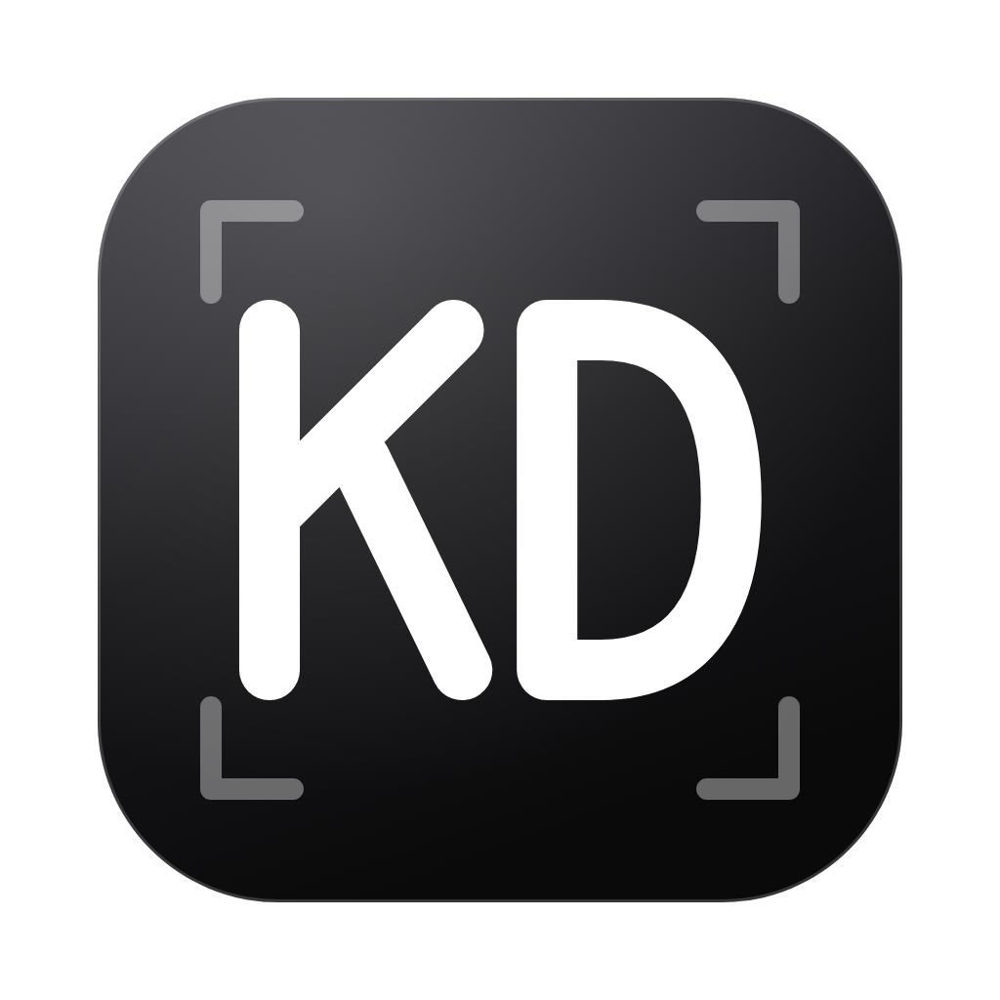

<p align="center">
  
</p>

<h1 align="center">KlikDesign</h1>

<p align="center">
  A free, open-source poster editor for the desktop. Describe a poster and the AI lays it out; refine it on the canvas or by chat. Bring your own AI keys; designs are saved on your machine.
</p>

<p align="center">
  <a href="LICENSE"></a>
  
  
  
  <a href="https://github.com/ashafizullah/klikdesign/actions/workflows/ci.yml"></a>
  <a href="https://github.com/ashafizullah/klikdesign/releases/latest"></a>
  <a href="https://github.com/ashafizullah/klikdesign/releases"></a>
</p>

<p align="center">
  <a href="https://trakteer.id/adamshafizullah/tip"></a>
</p>

<p align="center">
  Part of <a href="https://klikapps.pages.dev"><b>Klik Apps</b></a>, a family of free, open-source desktop apps: <a href="https://klikapps.pages.dev">klikapps.pages.dev</a>
</p>

## Features

- **Prompt → poster**: describe what the poster is for, the key text and the mood; the AI picks a palette and fonts and lays out headline, copy, shapes and call to action on the page
- **Design from your project folder**: link a product's codebase and the AI researches it first (name, tagline, benefits, brand colors from Tailwind/CSS, logo and screenshots), then places the real logo on the poster. Read-only and sandboxed; `.env`, keys and `.git` are never read
- **Revise by chat**: "make the headline bigger", "try a darker palette"; the AI edits the elements and each request is a single undo step. Vision models can look at the result and fix their own layout
- **Canvas editor**: drag, resize, rotate, snap guides, multi-select, inline text editing, layers, lock/hide, align and arrange, undo/redo
- **Text, shapes and images**: 20 curated Google Fonts or your installed fonts, rectangles, ellipses, triangles, stars and lines, solid or gradient fills, outlines and shadows, Lucide icons, QR codes, uploaded photos and logos
- **Templates and sizes**: Instagram post and story, A4, poster, banner or a custom size
- **Export** to PNG and JPG (0.5×–3×), PDF for print, and SVG
- **Bring your own model**: Anthropic or any OpenAI-compatible API; keys are stored in the OS keychain
- **Built-in terminal** (Ctrl+`): your own login shell, opened in the project folder. It runs commands with your user's permissions, like any terminal
- **Works with Claude Code**: turn on the local MCP server and your own Claude Code can lay out and edit designs, place images, look at the result and export
- **Auto-save** to a local library, and **auto-update** from GitHub Releases (signed packages)
- **English and Bahasa Indonesia** interface

## Using Claude Code

KlikDesign can be driven by [Claude Code](https://claude.com/claude-code) installed on your own computer, signed in with your own account (including Pro/Max plans):

1. Open a design, open the terminal (Ctrl+`) and click **Connect Claude Code**.
2. Enable the local MCP server and copy the `claude mcp add …` command. Run it once in any terminal.
3. Start `claude` and ask for changes, e.g. *"make a launch poster for our new feature"*. Edits appear live in KlikDesign and can be undone.

The server only listens on `127.0.0.1` and requires a secret token. KlikDesign never runs Claude Code, sends it prompts or touches your Claude credentials: you add the server and start Claude Code yourself (the terminal's **Type claude** button only types the command; you press Enter).

## Download

Get the latest version from **[Releases](https://github.com/ashafizullah/klikdesign/releases/latest)**:

| Platform | File |
|---|---|
| macOS 11+ (Apple Silicon & Intel) | `KlikDesign_x.y.z_universal.dmg` |
| Windows 10/11 (x64) | `KlikDesign_x.y.z_x64-setup.exe` or `.msi` |
| Linux x86_64 | `.deb`, `.rpm` or `.AppImage` |

**macOS:** open the DMG and drag KlikDesign into Applications. KlikDesign is signed and notarized by Apple, so it opens without a Gatekeeper warning. Or use the install script, which downloads the latest DMG, copies KlikDesign into Applications and opens it:

```sh
curl -fsSL https://raw.githubusercontent.com/ashafizullah/klikdesign/main/install.sh | bash
```

**Windows:** SmartScreen may warn about an unsigned app. Click **More info → Run anyway**.

## Privacy

KlikDesign has no account, telemetry or server of its own. Designs, images and settings are stored on your computer, and API keys are kept in the OS keychain. The app only connects to:

- **the AI provider you configure**, which receives your prompts and the design (and a rendered image for vision models). With a linked project folder, it also receives the files the AI reads there
- **Google Fonts**, to load the curated fonts
- **GitHub**, to check for and download updates

If you connect Claude Code, it sends what KlikDesign's tools return (such as the design and rendered images) to Anthropic under your own account.

## Requirements

- An API key for a chat model (Claude, GPT, Gemini, Grok, OpenRouter…), or a local OpenAI-compatible server such as Ollama
- An internet connection for Google Fonts

## Development

Requires [Bun](https://bun.sh/) and stable Rust.

```sh
bun install
bun run tauri dev      # run
bun run dev            # UI only, in the browser with mocked IPC
bun run tauri build    # bundle
bun run test           # frontend tests
cargo test --manifest-path src-tauri/Cargo.toml
```

## Contributing

Issues and pull requests are welcome. CI runs type checks, tests, `cargo fmt`, `clippy` and `cargo test` on macOS, Windows and Linux. Please run them locally before opening a PR. See [CONTRIBUTING.md](CONTRIBUTING.md) for setup, checks and guidelines.

### Releasing

Add a `## x.y.z` section to `CHANGELOG.md`, bump `version` in `tauri.conf.json`, `Cargo.toml` (and `Cargo.lock`) and `package.json`, then push a tag. CI builds the signed and notarized macOS DMG, the Windows installers and the Linux packages, signs the update packages and attaches everything (including `latest.json` for the in-app updater) to a draft release. Publish the draft to roll it out: installed apps only see published releases.

Releases need the `TAURI_SIGNING_PRIVATE_KEY` secret (its public key is in `tauri.conf.json`) plus `APPLE_CERTIFICATE`, `APPLE_CERTIFICATE_PASSWORD`, `APPLE_ID`, `APPLE_PASSWORD` and `APPLE_TEAM_ID` for macOS signing and notarization.

```sh
git tag v0.1.0 && git push origin v0.1.0
```

## Support

KlikDesign is free. If it saves you time, **[buy me an AI token on Trakteer](https://trakteer.id/adamshafizullah/tip)** ☕🤖.

## License

[MIT](LICENSE)

The app bundles third-party software, including the interface fonts Fraunces, IBM Plex Sans and IBM Plex Mono (SIL Open Font License 1.1) and the Lucide icons (ISC). Their licenses are in [`THIRD_PARTY_NOTICES.md`](THIRD_PARTY_NOTICES.md), which the app also shows under Settings → Open-source licenses. Run `bun run notices` after changing dependencies.

Claude and Claude Code are trademarks of Anthropic. KlikDesign is an independent project and is not affiliated with or endorsed by Anthropic. QR Code is a registered trademark of DENSO WAVE INCORPORATED. Other product names are trademarks of their respective owners.

<p>
  <a href="https://github.com/ashafizullah"></a>
  &nbsp;Built by <a href="https://github.com/ashafizullah"><b>Adam Suchi Hafizullah</b></a>
</p>
